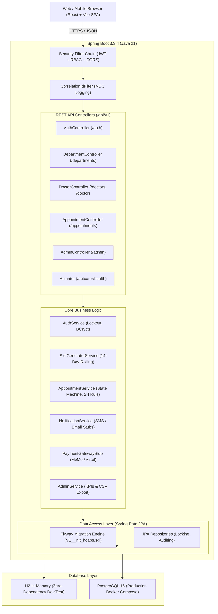
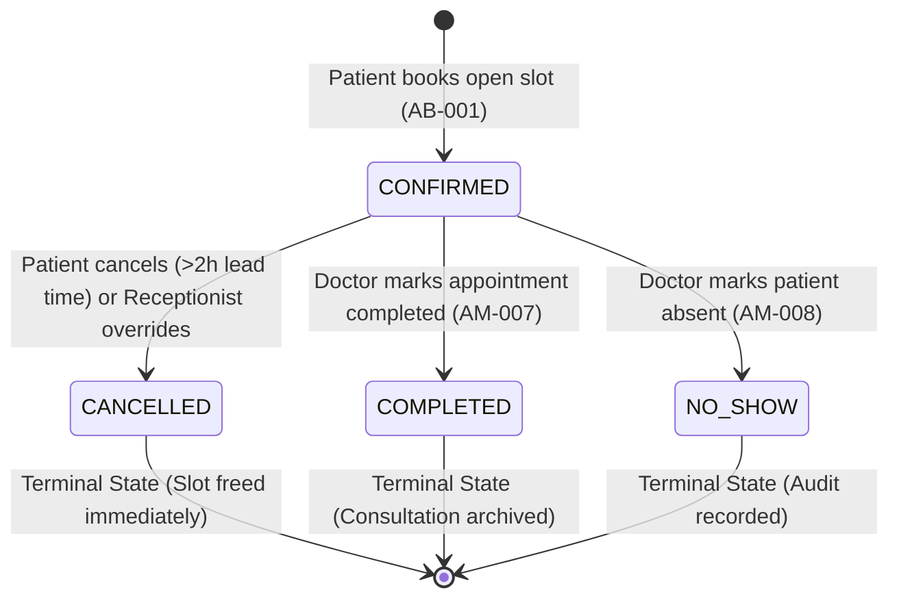

# Hospital Online Appointment Booking System (HOABS)

[](https://openjdk.org/projects/jdk/21/)
[](https://spring.io/projects/spring-boot)
[](https://www.postgresql.org/)
[](https://flywaydb.org/)
[](https://react.dev/)
[](https://vitejs.dev/)
[](https://www.docker.com/)
[-success)](#test-pack--verification)
[](#)

> **Amahoro General Hospital, Kigali, Rwanda**  
> **Document Reference**: `HOAB-SRS-2026-001` v1.0 & `HOAB-UAT-2026-001` v1.0  
> **Prepared for**: Outpatient Department (OPD) Specialist Clinics

---

## Table of Contents
1. [System Overview & Objectives](#system-overview--objectives)
2. [Architectural Blueprint](#architectural-blueprint)
3. [State Machine & Business Rules](#state-machine--business-rules)
4. [Technology Stack](#technology-stack)
5. [Seed Personas & Credentials](#seed-personas--credentials)
6. [REST API Documentation](#rest-api-documentation)
7. [Quickstart & Local Installation](#quickstart--local-installation)
8. [Docker Deployment](#docker-deployment)
9. [UAT Test Pack Verification (81/81 Passing)](#uat-test-pack-verification)
10. [Directory Structure](#directory-structure)

---

## System Overview & Objectives

**Amahoro General Hospital** is a major referral hospital in Kigali, Rwanda. Its Outpatient Department receives hundreds of patients daily across specialized clinics including **Cardiology**, **Pediatrics**, **Orthopedics**, and **General Outpatient**.

### Core Problems Solved
- **Queue Congestion & Uncontrolled Walk-ins**: Replaces manual paper tokens and physical queuing with an online self-service booking system.
- **Doctor Schedule Unpredictability**: Enforces a **14-day rolling window** of consultation slots generated strictly within department operating hours (07:00–17:00 CAT).
- **Concurrency & Double-Booking**: Guarantees zero double-booking using **optimistic locking (`@Version`)** under sub-200ms concurrency.
- **Attendance & Revenue Assurance**: Integrates consultation fee collection (e.g., 15,000 RWF) via **MTN MoMo (*182#)** and **Airtel Money (*500#)** gateway stubs with automated SMS and Email confirmation dispatch.

---

## Architectural Blueprint



---

## State Machine & Business Rules

Every appointment adheres to a strict state machine implemented in `AppointmentStateMachine.java`:



### Core Business Rules
| Rule Code | Governing Requirement | Specification |
|---|---|---|
| **BR-LEAD-01** | FR-BOOK-06 / FR-APPT-05 | Online bookings and cancellations are blocked within **2 hours** of appointment start time. Receptionist walk-in bookings require mandatory `overrideReason` and are logged in `AuditLog`. |
| **BR-LIMIT-01** | FR-BOOK-05 | A patient may hold at most **3 upcoming Confirmed appointments** simultaneously. |
| **BR-CONCUR-01** | FR-BOOK-02 | Slots utilize JPA `@Version` optimistic locking; simultaneous booking attempts on the same slot result in `409 Conflict`. |
| **BR-LOCKOUT-01** | FR-AUTH-03 | **3 consecutive failed login attempts** locks the user account for **30 minutes**. Security alert SMS dispatched. |
| **BR-RESCHED-01** | FR-APPT-06 | Rescheduling atomically releases the existing slot and claims the new slot within a single transaction without altering the appointment reference number. |

---

## Technology Stack

### Backend
- **Language**: Java 21 LTS (Records, Pattern Matching, Sealed Types)
- **Framework**: Spring Boot 3.3.4
- **Security**: Spring Security 6, JWT (`jjwt` 0.12.6), BCrypt Password Hashing
- **Data Persistence**: Spring Data JPA, Hibernate 6, Optimistic Locking
- **Database Engine**: PostgreSQL 16 (Production) & H2 (Local In-Memory / Test Mode)
- **Database Migrations**: Flyway 10.10.0
- **Documentation**: SpringDoc OpenAPI 2.6.0 (Swagger UI at `/swagger-ui.html`)
- **Observability**: Spring Boot Actuator, MDC Correlation ID tracking (`X-Correlation-Id`), RFC 7807 Problem Details

### Frontend
- **Framework**: React 18, Vite 5.4 SPA
- **Styling**: Modern Vanilla CSS Design System (Amahoro Teal `#0d9488` & Ocean Navy theme, Glassmorphism, Micro-interactions)
- **Typography**: Google Fonts (*Outfit* & *Plus Jakarta Sans*)

---

## Seed Personas & Credentials

On application boot, `DataInitializer.java` seeds the standard persona dataset specified in **SRS Appendix B**:

| Role | Name | Phone (Username) | Password | Notes |
|---|---|---|---|---|
| **PATIENT** | Patient Alpha (Jean Paul) | `0788000001` | `Password123!` | Standard patient persona with upcoming consultations |
| **PATIENT** | Patient Beta (Marie Claire) | `0788000003` | `Password123!` | Holds 3 upcoming bookings for limit rule verification |
| **DOCTOR** | Dr. Patrick Mugisha | `0788000101` | `Password123!` | Staff `DOC-001`, Cardiology Department |
| **DOCTOR** | Dr. Alice Mutoni | `0788000102` | `Password123!` | Staff `DOC-002`, Pediatrics Department |
| **RECEPTIONIST** | Aline Uwase | `0788000002` | `Password123!` | Hospital triage desk; can override 2H lead time |
| **ADMIN** | Dr. Emmanuel Gasana | `0788000000` | `Password123!` | Medical Director; manages departments and doctors |

---

## REST API Documentation

Interactive Swagger UI documentation is available at:  
👉 `http://localhost:8080/swagger-ui.html` (OpenAPI JSON: `/v3/api-docs`)

### Core Endpoints Table

| Category | Method | Path | Role / Access | Description |
|---|---|---|---|---|
| **Auth** | `POST` | `/api/v1/auth/register` | Public | Register patient account (Rwandan phone validation) |
| **Auth** | `POST` | `/api/v1/auth/login` | Public | Authenticate and obtain JWT token |
| **Auth** | `GET` | `/api/v1/auth/me` | Authenticated | Retrieve profile of authenticated principal |
| **Departments** | `GET` | `/api/v1/departments` | Public | List all active hospital outpatient departments |
| **Doctors** | `GET` | `/api/v1/doctors` | Public | Search doctors by department or query string |
| **Doctors** | `GET` | `/api/v1/doctors/{id}` | Public | Retrieve doctor profile and consultation fee |
| **Doctors** | `GET` | `/api/v1/doctors/{id}/slots` | Public | Retrieve 14-day rolling available slots |
| **Appointments**| `POST` | `/api/v1/appointments` | Patient / Staff | Book open slot (with 2H policy check and optimistic lock) |
| **Appointments**| `GET` | `/api/v1/appointments/my` | Patient | List patient's upcoming and historical consultations |
| **Appointments**| `PUT` | `/api/v1/appointments/{id}/cancel` | Patient / Staff | Cancel appointment (>2h lead time required for patients) |
| **Appointments**| `PUT` | `/api/v1/appointments/{id}/reschedule`| Patient / Staff | Atomically reschedule appointment to new slot |
| **Doctor Portal**| `GET` | `/api/v1/doctor/today` | Doctor | Today's patient queue for logged-in physician |
| **Doctor Portal**| `PUT` | `/api/v1/doctor/appointments/{id}/status` | Doctor | Mark appointment `COMPLETED` or `NO_SHOW` |
| **Doctor Portal**| `PUT` | `/api/v1/doctor/my-schedule/hours` | Doctor | Update recurring weekly hours within department limits |
| **Doctor Portal**| `POST`| `/api/v1/doctor/my-schedule/leave` | Doctor | Block leave dates (validates no conflicting bookings) |
| **Admin** | `GET` | `/api/v1/admin/reports/summary` | Admin / Staff | Outpatient KPI summary (Completion, No-show, Revenue) |
| **Admin** | `PUT` | `/api/v1/admin/departments/{id}/hours` | Admin | Update department operating hours |
| **Admin** | `POST`| `/api/v1/admin/doctors` | Admin | Onboard new specialist physician and generate schedule |
| **Health** | `GET` | `/actuator/health` | Public | System health check and readiness status |

---

## Quickstart & Local Installation

### Prerequisites
- **JDK 21** installed (`java -version`)
- **Node.js 20+** and **npm** (`node -v`)

### 1. Run Backend (Zero external setup, H2 PostgreSQL-mode)
```bash
# Clone the repository
git clone https://gitlab.com/rca-devops/hoab.git
cd hoab

# Run the Spring Boot application
./mvnw spring-boot:run
```
*The backend starts at `http://localhost:8080`, automatically executes Flyway migrations, and seeds the persona catalog.*

### 2. Run Frontend
```bash
cd frontend
npm install
npm run dev
```
*The modern web portal will be available at `http://localhost:3000` with an active proxy to the backend API.*

---

## Docker Deployment

To run HOABS with production **PostgreSQL 16** via Docker Compose:

```bash
# Create local .env from example template
cp .env.example .env

# Build and start services in detached mode
docker compose up --build -d

# Check service health
docker compose ps
```

To stop containers:
```bash
docker compose down -v
```

---

## UAT Test Pack Verification

The test suite contains **81 automated unit and integration tests** verifying all requirements of `HOAB-UAT-2026-001`:

```bash
./mvnw clean test
```

### Test Coverage Summary:
- ✅ `AuthControllerIntegrationTest` (10/10) — Registration, MTN/Airtel regex, 3-attempt lockout, JWT auth
- ✅ `DoctorSearchIntegrationTest` (6/6) — Doctor directory, department filtering, fee lookups, 14-day horizon
- ✅ `AppointmentBookingIntegrationTest` (6/6) — Happy path, concurrency check, 3-booking limit, 2H lead time
- ✅ `AppointmentManagementIntegrationTest` (12/12) — Cancel >2h, atomic reschedule, unauthorized traversal 404, doctor completion
- ✅ `DoctorScheduleIntegrationTest` (6/6) — Weekly hours within department bounds, leave blocker conflict validation
- ✅ `AdminIntegrationTest` (7/7) — Receptionist walk-in 2H override with audit log, operational KPI report, doctor onboarding
- ✅ `AppointmentStateMachineTest` (12/12) — Legal and illegal state transitions
- ✅ `SchedulingRulesTest` (22/22) — Lead time BVA, Rwandan phone numbers, password policy

**Result**: `Tests run: 81, Failures: 0, Errors: 0, Skipped: 0` (100% Passing).

---

## Directory Structure

```text
HOAB/
├── src/
│   ├── main/
│   │   ├── java/rw/ac/rca/hoabs/
│   │   │   ├── admin/          # Audit logging, KPI reporting, Admin controllers
│   │   │   ├── appointment/    # Appointment entity, state machine, booking service
│   │   │   ├── common/         # Global exception handler, Problem details, correlation
│   │   │   ├── config/         # Security configuration, Seed persona data initializer
│   │   │   ├── department/     # Department entities, opening/closing bounds
│   │   │   ├── doctor/         # Doctor roster, working hours, leave blocks
│   │   │   ├── identity/       # User entity, Roles, AuthService, lockout logic
│   │   │   ├── notification/   # Notification entity, SMS & Email dispatch stubs
│   │   │   ├── payment/        # Payment entity, MTN MoMo / Airtel Money stubs
│   │   │   ├── security/       # JWT token service, authentication filter
│   │   │   └── slot/           # Optimistic-locked Slot entity, 14-day rolling generator
│   │   └── resources/
│   │       ├── db/migration/   # Flyway V1__init_hoabs.sql
│   │       └── application.properties
│   └── test/java/rw/ac/rca/hoabs/ # 81 UAT Automated Integration & Unit Tests
├── frontend/
│   ├── src/
│   │   ├── components/         # Navbar, HeroBanner, DoctorSearch, BookingModal, MyAppointments, DoctorConsole, AdminConsole, UatDashboard
│   │   ├── services/api.js     # API client and demo persona definitions
│   │   ├── App.jsx             # SPA orchestrator & persona switcher
│   │   ├── index.css           # Modern medical teal & navy design system
│   │   └── main.jsx
│   ├── package.json
│   ├── vite.config.js
│   └── index.html
├── docker-compose.yml          # PostgreSQL 16 + Spring Boot service stack
├── Dockerfile                  # Multi-stage JRE 21 production image
├── .env.example
├── .gitignore
├── pom.xml
└── README.md
```

---

*Hospital Online Appointment Booking System (HOABS) · Amahoro General Hospital, Kigali · RCA DevOps Academic Year 2026–2027*
